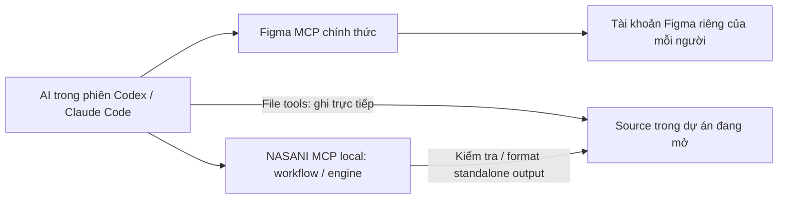

# NASANI MCP

Project Node độc lập cho luồng **Figma → code trong dự án → kiểm tra/format bằng NASANI**. Chứa bản riêng của engine HTML/CSS, SVG và Swiper hiện có; không cần Laravel, PHP, database hoặc thư mục `tools123`.

## Cài skill giống Hallmark

```sh
npx skills add phamtuyennasani/nasani-mcp -g
```

Lệnh phát hiện skill `nasani-figma` ngay từ repo này; không cần publish npm. `-g` cài skill ở phạm vi người dùng để dùng cho nhiều dự án. CLI `skills` hiện yêu cầu Node.js >=22.20 và Git. Chạy trong Terminal để chọn client theo menu; khi chạy bên trong một AI coding agent, CLI có thể tự chọn agent đó. Muốn cài rõ cho **cả Codex và Claude Code**, dùng:

```sh
npx skills add phamtuyennasani/nasani-mcp -g --agent codex claude-code --yes
```

Chỉ dùng một client thì giữ `codex` hoặc `claude-code` trong `--agent`. Lệnh này cài **skill, tài liệu và helper**, chưa chạy installer MCP hay đăng nhập Figma. Mở dự án trong AI client và yêu cầu:

> Dùng skill nasani-figma triển khai frame [link Figma] vào [route/component] trong dự án đang mở. Nếu có skill figma-design-to-code thì dùng nó; nếu không, gọi get_design_context trực tiếp. Nếu Figma trả lỗi thì báo lỗi thực tế. Chỉ dùng NASANI runner khi đã có output cần kiểm tra.

Ở lần dùng đầu, skill hướng dẫn AI chạy helper `scripts/nasani.cjs`: tự tải runtime cố định, đăng ký MCP cho đúng dự án và gọi MCP thật qua STDIO. Nếu client chưa nạp tool mới, helper tiếp tục gọi validate/format/assets ngay trong phiên hiện tại; tên tool native `nasani_*` chỉ xuất hiện sau khi client nạp lại MCP. AI cần quyền chạy shell; trust/approval vẫn theo chính sách client. Kết nối Figma MCP riêng bằng tài khoản của bạn.

Khi runtime và cấu hình đã sẵn sàng, helper gọi MCP ngay, không chạy lại setup/in hướng dẫn cài đặt ở mỗi tool. Nó vẫn kiểm tra cấu hình xung đột và symlink; thiếu runtime hoặc cấu hình thì mới chạy setup. Skill dùng lại environment và dữ liệu Figma đã có cho cùng dự án/server trong phiên; chỉ kiểm tra lại môi trường khi root/cấu hình/runtime thay đổi hoặc có lỗi kết nối/dependency. Nếu skill đã được đọc thì không cần gọi thêm `nasani_workflow`.

Nếu muốn **cài MCP ngay trong Terminal**, không chờ AI dùng skill lần đầu, chạy tại dự án:

```sh
npx --yes git+https://github.com/phamtuyennasani/nasani-mcp.git setup --client both --mcp-only
```

Thay `both` bằng `codex` hoặc `claude` nếu chỉ dùng một client. Lưu ý tên Claude của `skills` là `claude-code`, còn installer NASANI/helper dùng `claude`. MCP được đăng ký riêng cho từng dự án để giữ đúng thư mục được phép xử lý; skill global không tự mở quyền cho các dự án khác. Mở phiên mới/reload MCP và chấp thuận trust/MCP khi client yêu cầu để dùng tool native.

Cập nhật riêng skill đã cài global:

```sh
npx skills update nasani-figma -g
```

Nếu vẫn thấy thông báo “Thiếu NASANI MCP runtime”, hãy cập nhật skill rồi mở phiên mới để AI đọc hướng dẫn/helper mới. Lệnh cập nhật skill không cập nhật runtime MCP đã có; `setup` dùng để cập nhật runtime. Xem [CLI skills chính thức](https://github.com/vercel-labs/skills/blob/main/docs/commands.md) về lựa chọn client, phạm vi cài và cập nhật.

## Cài trọn MCP, skill và agent bằng một lệnh

Mở Terminal **tại thư mục dự án cần triển khai**, rồi chạy (cần Git và Node.js >=22):

```sh
npx --yes git+https://github.com/phamtuyennasani/nasani-mcp.git setup
```

Chọn client rồi Enter:

```text
1) Codex
2) Claude Code
3) Cả hai
```

Enter không nhập số mặc định chọn Codex. Lệnh tự tải công cụ, cài runtime cố định ở `~/.local/share/nasani-mcp/runtime/` và thêm MCP, skill, agent cho dự án hiện tại. Config không trỏ vào cache `npx`; dọn cache vẫn dùng được MCP. Không cần clone repo thủ công, export biến, copy file hay chạy server riêng. Chạy lệnh này tại mỗi dự án muốn dùng; không thay trust/approval hay cấu hình global của AI client.

Không dùng menu thì chỉ định sẵn:

```sh
npx --yes git+https://github.com/phamtuyennasani/nasani-mcp.git setup --client both
```

Thay `both` bằng `codex` hoặc `claude`; thêm `--mcp-only` nếu chỉ muốn MCP. Có thể dùng `--project /duong-dan-tuyet-doi/du-an` thay cho thư mục hiện tại. Chạy lại giữ nguyên config phù hợp; nếu NASANI/skill đã tùy chỉnh thì báo xung đột, không tự ghi đè. Các dự án dùng chung runtime local này. Đường cài thủ công bên dưới vẫn dùng được.

Sau cài, mở lại đúng dự án trong Codex/Claude và chấp thuận MCP/trust khi được hỏi. Gửi yêu cầu triển khai Figma; AI phải gọi Figma MCP đang có trước. Không cần gọi `nasani_environment` trước khi đọc Figma. Chỉ khi có output standalone cần validate/format/assets mới gọi environment một lần, rồi dùng lại kết quả. Kết nối Figma MCP bằng tài khoản riêng của từng người; installer NASANI không tự đăng nhập Figma.

## Dùng ngay trong phiên AI coding

Luồng mặc định là **MCP local**, cài vào Codex/Claude đang dùng. AI của phiên hiện tại đọc dữ liệu từ Figma MCP, phân tích và ghi code trực tiếp vào dự án bằng file tools của client. NASANI cung cấp workflow và engine xử lý; không tạo ZIP trừ khi người dùng yêu cầu.

```text
Bạn gửi link Figma trong Codex/Claude
  → AI dùng skill Figma nếu có, gọi get_design_context trực tiếp
  → NASANI nhận context và hướng dẫn triển khai, không probe Figma
  → AI của phiên hiện tại phân tích và ghi code vào dự án
  → NASANI kiểm tra/format output phù hợp, AI render và sửa tiếp
```

Không cần URL server NASANI, token NASANI, trang web cấu hình hoặc API key AI riêng. NASANI không đọc token đăng nhập Codex/Claude: phần suy luận diễn ra trong client theo quyền sử dụng của phiên đang mở. Bạn vẫn phải kết nối Figma MCP bằng tài khoản Figma của mình và cho AI client quyền sửa dự án.

Cài **chỉ MCP** (Git và Node.js >=22). Đặt công cụ ở một thư mục cố định, riêng với dự án cần triển khai:

```sh
mkdir -p "$HOME/.local/share"
git clone https://github.com/phamtuyennasani/nasani-mcp.git "$HOME/.local/share/nasani-mcp"
export NASANI_HOME="$HOME/.local/share/nasani-mcp"
npm ci --ignore-scripts --prefix "$NASANI_HOME"

cd /duong-dan-tuyet-doi/du-an-cua-ban
node "$NASANI_HOME/bin/nasani.cjs" install --client codex --project "$PWD" --mcp-only
```

`NASANI_HOME` là source của công cụ; `--project` là dự án được phép đọc/format. Chạy installer cho mỗi dự án đích. Nếu đã clone công cụ thì bỏ bước clone, dùng đường dẫn hiện có và chạy `npm ci --ignore-scripts` ở đó. Claude Code dùng `--client claude`. Không cần chép skill/agent khi dùng `--mcp-only`: tool `nasani_workflow` trả hướng dẫn được đóng gói trong MCP.

Sau khi cài:

1. **Codex:** mở đúng dự án và đánh dấu dự án đó là trusted qua client, rồi mở phiên mới/reload MCP. Codex có thể bỏ qua `.codex/config.toml` của dự án chưa trusted; trust thư mục cha hoặc chỉ mở lại chưa chắc đủ. Installer không tự thay cấu hình trust global. Khi format, chấp thuận `nasani_format` nếu client yêu cầu quyền ghi.
2. **Claude Code:** mở phiên trong dự án, chấp thuận project MCP từ `.mcp.json`, dùng `/mcp` kiểm tra NASANI đã kết nối. Chấp thuận quyền gọi tool format khi được hỏi.
3. Khi cần dùng NASANI runner, yêu cầu AI gọi `nasani_environment`. `mode` phải là `local`, `project_root` phải đúng thư mục dự án đích. Nếu sai root, sửa cấu hình/cài lại trước khi dùng runner.
4. Kết nối **Figma MCP chính thức** trong cùng client bằng tài khoản Figma của từng người. Nếu đã có plugin Figma đang hoạt động thì dùng luôn, không thêm entry trùng.

Nếu chưa cài Figma, ưu tiên plugin Figma chính thức của client. Cách đăng ký server thủ công:

```sh
# Codex: chạy một lần rồi đăng nhập bằng tài khoản Figma của bạn.
codex mcp add figma --url https://mcp.figma.com/mcp
codex mcp login figma

# Hoặc Claude Code: chạy trong dự án, mở phiên mới rồi /mcp → figma → Authenticate.
claude mcp add --transport http figma https://mcp.figma.com/mcp
```

Đăng nhập trên trang Figma và chọn Allow access. Mỗi người chỉ đọc được các file mà tài khoản của họ có quyền xem. Không nhập token Figma/AI vào NASANI. Xem [hướng dẫn Figma chính thức](https://developers.figma.com/docs/figma-mcp-server/remote-server-installation/) nếu giao diện client khác.

Sau khi client thấy các tool NASANI và Figma, yêu cầu:

> Dùng NASANI triển khai frame Figma [link của tôi] vào route/component [đích] của dự án đang mở. Nếu có skill figma-design-to-code thì dùng nó; nếu không, gọi get_design_context trực tiếp, không chạy Figma health check. Nếu Figma lỗi thì báo lỗi thực tế; nếu thành công, ghi code trực tiếp vào source rồi chỉ dùng NASANI runner cho output cần kiểm tra.

`nasani_workflow` nhận URL Figma, đích và tùy chọn tóm tắt context do AI lấy từ Figma MCP; dữ liệu thiết kế đầy đủ và screenshot có thể giữ trong context của phiên. Kết quả có `figma_handoff` yêu cầu host dùng skill Figma chính thức nếu có, hoặc gọi `get_design_context` trực tiếp; context đã cung cấp được tái sử dụng và chỉ phần thiếu mới được đọc thêm. Tool này không probe Figma, không tự suy luận và không âm thầm gọi lại AI. Nếu tool không có hoặc lời gọi Figma lỗi, host báo lỗi thực tế. Codex/Claude điều phối các MCP; NASANI không truy cập phiên đăng nhập của một MCP khác.

Với output standalone, sau khi tạo đủ source/assets, gọi `nasani_format` để kiểm tra asset, validate trước/sau và format trong một lượt. Không cần chuỗi mặc định `validate → assets → format → validate` trên cùng đầu ra không đổi. Dùng `nasani_validate` cho audit chỉ đọc/chẩn đoán lỗi hoặc sau khi sửa tiếp; dùng `nasani_assets` khi cần danh sách asset/chẩn đoán. Kiểm tra build/lint/type phù hợp và so sánh browser vẫn thực hiện sau triển khai.

## Chọn cách chạy

| Cách chạy | Code nằm ở đâu? | Engine chạy ở đâu? | Cần host? |
| --- | --- | --- | --- |
| `local` | Máy developer | Máy developer, không gửi mạng | Không |
| `bridge` | Máy developer | Host NASANI; nhận bundle của một output | Có |
| HTTP trực tiếp | AI client tự gửi/nhận bundle | Host NASANI | Có |

**Local là mặc định cho luồng trên.** Bridge/HTTP chỉ cần khi bạn chủ động chọn chạy engine trên host riêng; hướng dẫn đã tách vào `deploy/README.md`. Server từ xa không đọc được đường dẫn trên máy thành viên. Bridge gửi hai source và assets được tham chiếu rồi nhận kết quả; chỉ ghi lại hai source khi chúng chưa bị sửa trong lúc chờ.



AI host điều phối Figma MCP và NASANI. Mỗi người kết nối Figma MCP chính thức bằng tài khoản của họ. Luồng local không cần `FIGMA_CLIENT_ID` hay `FIGMA_CLIENT_SECRET`; quyền truy cập file và hạn mức Figma vẫn do Figma quyết định.

## Skill và agent cài kèm — tùy chọn

Nếu muốn skill được client phát hiện riêng và có agent chuyên trách, bỏ `--mcp-only`:

```sh
node bin/nasani.cjs install --client codex --project /duong-dan-tuyet-doi/du-an-cua-ban
```

Dùng Claude Code thì thay `codex` bằng `claude`. Lệnh `install` cài MCP config, skill và agent vào **dự án đích**, không thay cấu hình global:

| Client | MCP config | Skill | Agent |
| --- | --- | --- | --- |
| Codex | `.codex/config.toml` | `.agents/skills/nasani-figma/` | `.codex/agents/nasani-figma.toml` |
| Claude Code | `.mcp.json` | `.claude/skills/nasani-figma/` | `.claude/agents/nasani-figma.md` |

Installer giữ cấu hình không liên quan, chạy lại cùng cấu hình sẽ không ghi thêm. Nếu đã có entry NASANI khác hoặc skill/agent đã tùy biến, nó báo xung đột để bạn sửa rõ ràng; không tự ghi đè. Cấu hình dùng đường dẫn tuyệt đối tới Node và CLI của bản NASANI này: nếu di chuyển NASANI hoặc thay Node, cập nhật entry đó trước khi cài lại. Chỉ chạy installer sau khi đã đặt NASANI ở vị trí ổn định.

Mở lại dự án trong AI client, chấp thuận MCP theo giao diện client nếu được hỏi. Chỉ kiểm tra `nasani_environment` khi tác vụ cần NASANI runner. Agent dùng tên `nasani_figma` trong Codex hoặc `nasani-figma` trong Claude. Ví dụ yêu cầu:

> Dùng skill nasani-figma để triển khai frame Figma tôi gửi vào route hiện tại. Đọc cấu trúc dự án, dùng Figma MCP lấy context và assets, triển khai rồi chạy các kiểm tra phù hợp.

Skill chọn cấu trúc/framework của dự án hiện có. Validator NASANI chỉ dành cho output standalone `index.html` + `style.css`; không áp đặt cấu trúc static lên React/Vue/Laravel.

## Tool contract

| Tool | Input local / bridge | Input HTTP trực tiếp | Kết quả |
| --- | --- | --- | --- |
| `nasani_workflow` | `design_url`, `target`, `output_mode?`, `figma_context?` | Như local | Figma handoff + hướng dẫn; không kiểm tra kết nối Figma |
| `nasani_environment` | `{}` | `{}` | Runner dependencies/mode; chỉ gọi khi cần runner |
| `nasani_validate` | `directory`, `content_width`, options | `bundle`, `content_width`, options | Lỗi AST/policy |
| `nasani_format` | Như validate | Như validate | Local/bridge ghi 2 source; remote trả `source` |
| `nasani_assets` | `directory` | `bundle` | Assets đang được tham chiếu; không xóa |
| `nasani_swiper_scripts` | `directory`, `swipers` | `bundle`, `swipers` | Helper/app source và dependencies; không chạy JS |

`nasani_workflow.output_mode` mặc định `application`, hoặc `standalone`; `figma_context` là tóm tắt tùy chọn, tối đa 16.000 ký tự, không gửi token. Workflow không cần truy cập mạng và không ghi file. AI dùng file tools sẵn có để tạo/sửa source; `nasani_format` trực tiếp sửa hai file standalone.

`directory` là đường dẫn tương đối trong `--project`. Bundle là `{html, css, assets: [{path: "assets/icon.svg", base64: "…"}]}`. Options validate/format: `require_responsive_breakpoints`, `swipers`. Đọc contract chi tiết tại `skills/nasani-figma/references/standalone.md` hoặc lấy từ `nasani_workflow` với `output_mode: "standalone"`.

Giới hạn: HTML+CSS 16 MiB, mỗi asset 20 MiB, tổng assets 64 MiB, tối đa 512 assets, HTTP body 112 MiB kể cả base64/JSON. Job timeout 30 giây, Node worker heap 384 MiB; yêu cầu sát giới hạn có thể bị từ chối do timeout/bộ nhớ. HTTP mặc định tối đa 2 request đồng thời, 1 request/member, 120 request/phút/member; nhận 429 thì retry sau `Retry-After`. Không hỗ trợ JSON-RPC batch. Không ghi token, HTML/CSS/assets vào application logs. Worker riêng là giới hạn tài nguyên, không phải sandbox dành cho chạy code tùy ý; API không nhận script thực thi.

Chưa có billing, dashboard, OAuth NASANI, lưu lịch sử output hay hàng đợi phân tán. Bản này mặc định chạy local trong phiên AI coding; phần host từ xa là tùy chọn và cần thử trên host thật trước khi mở cho người dùng ngoài nhóm. Validator AST không chứng minh giống Figma; AI vẫn phải render và so sánh hình ảnh.

## Đóng gói và kiểm tra

```sh
npm test
npm pack --dry-run
npm pack
```

Gói npm đang đặt `private: true` để tránh publish nhầm. `.tgz` dùng được để cài nội bộ (`npm install -g /duong-dan/goi.tgz`, rồi gọi `nasani-mcp …`); khi nhận source thì dùng `npm ci`. Giữ lockfile khi đưa lên host. Không đưa `node_modules`, `.env`, `data`, token hoặc dự án khách hàng vào repository/gói phân phối.

Test dùng MCP SDK client thật để kiểm tra STDIO, HTTP, bridge, format, chặn đường dẫn, assets, token/revoke, sửa đồng thời, rollback và installer giữ cấu hình cũ. Docker/TLS cần kiểm tra thêm trên máy có Docker và tên miền thật.

Kết quả kiểm thử trên Figma thật và client Codex/Claude được ghi tại [TESTING.md](TESTING.md). Demo của khách hàng được giữ ở máy kiểm thử, không đưa vào repository công khai.

Tài liệu nền tảng chính thức: [MCP SDK](https://github.com/modelcontextprotocol/typescript-sdk/tree/v1.x), [Codex MCP](https://developers.openai.com/codex/mcp/), [Codex skills](https://developers.openai.com/codex/skills/), [Codex agents](https://developers.openai.com/codex/subagents/), [Claude MCP](https://code.claude.com/docs/en/mcp), [Figma MCP](https://developers.figma.com/docs/figma-mcp-server/remote-server-installation/).
